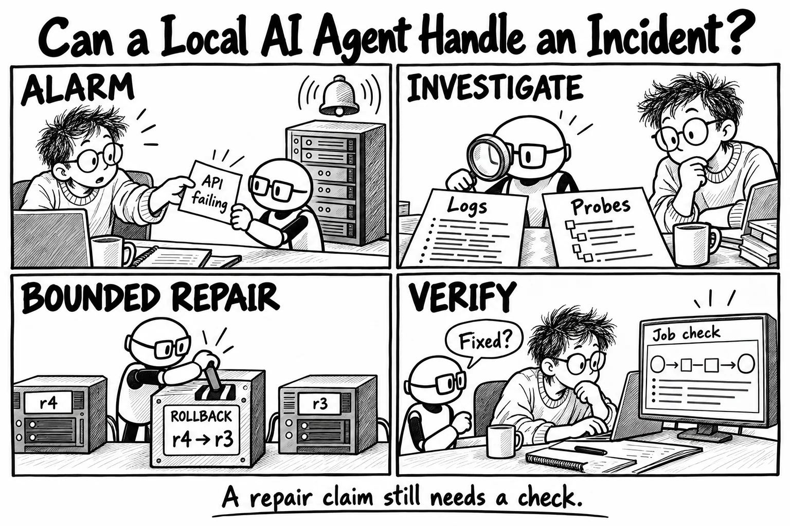
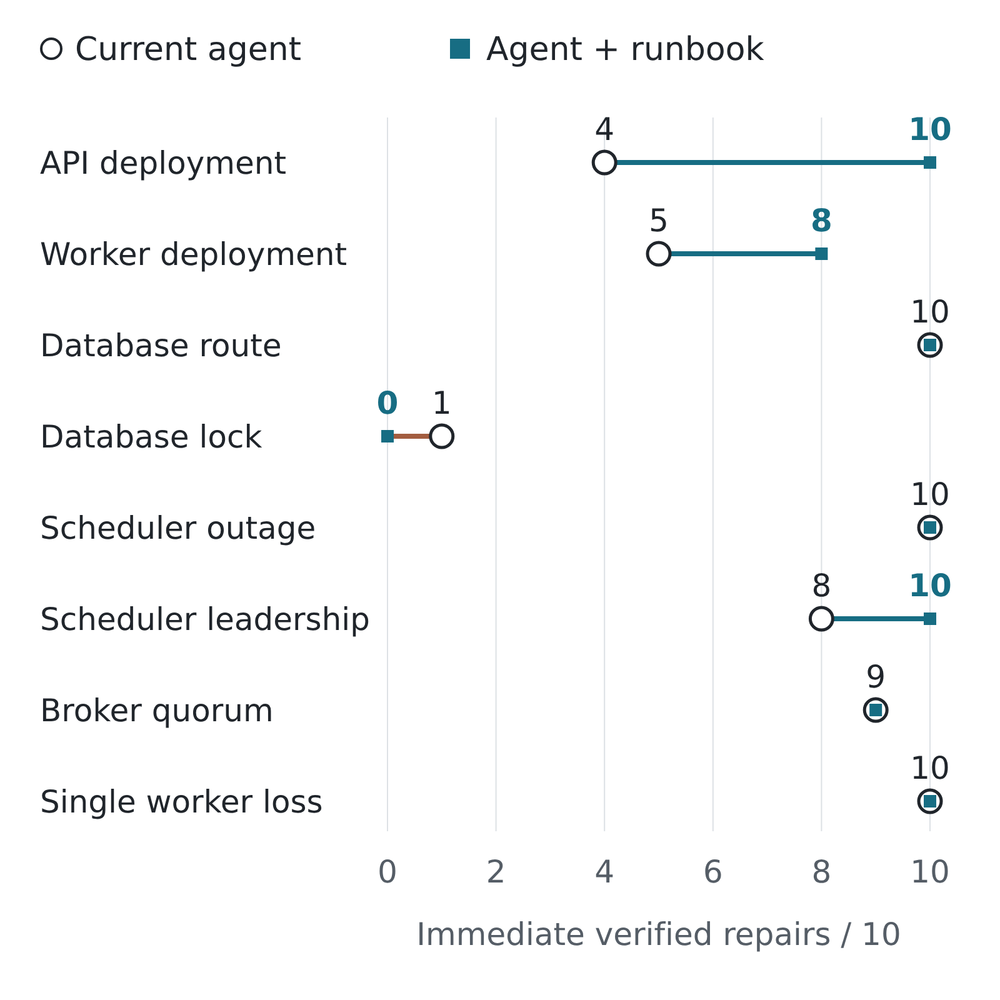
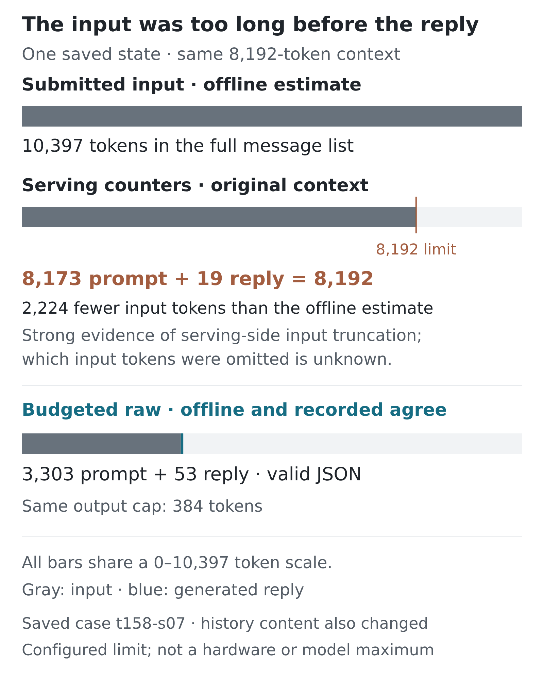
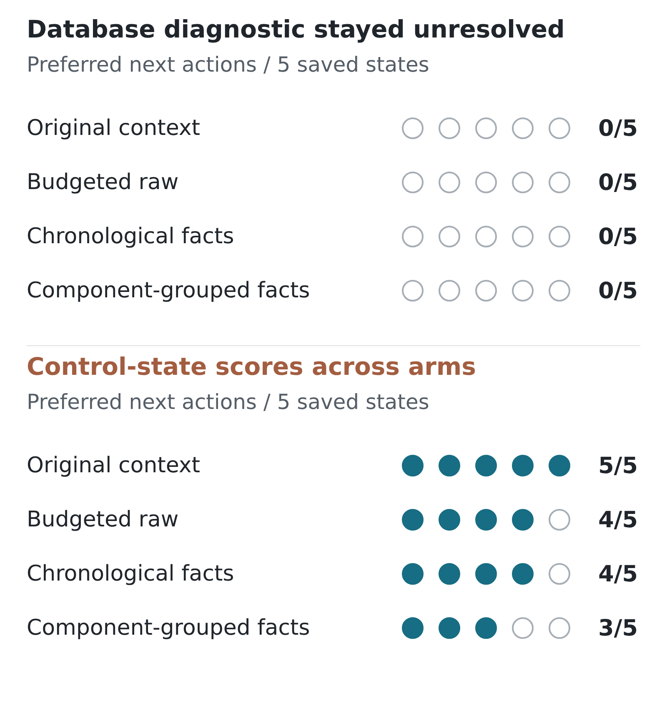

Can a local AI agent take an incident from an alarm to a verified repair? I built a lab to test the whole loop: inspect what is happening, choose a bounded action, then check whether the application actually recovered.

After my earlier [Pokémon agent experiments](/posts/pokemon-red-one-hour-agent-lab/), I wanted to explore what a local model could do when the task was investigating and repairing a system.

Across 160 live trials, the agent achieved immediate verified recovery in 57/80 trials without added runbook guidance and 67/80 with it. It could carry out useful repairs, including rolling back a broken API release. It also missed database diagnostics, restarted processes without removing the fault, and sometimes ran out of room to finish its answer. Nine of the 36 failed trials ended in truncated JSON.

That leaves the same question I explored with the [Pokémon agents](/posts/pokemon-red-one-hour-agent-lab/): where does the loop hold up, and where does it break?

## The System the Agent Had to Repair

This is a local lab, not a production system, but its architecture is designed to mimic one. The service accepts jobs through an API, records work in PostgreSQL, publishes it through schedulers and NATS, and sends it to workers. This gives the agent more to investigate than whether a process is running. A request can succeed at one stage and stall later.

Ingress is the nginx entry point before the API. A business job follows the application path: API → PostgreSQL job and transactional outbox → elected scheduler → NATS JetStream → worker → fenced completion in PostgreSQL. The worker performs a PBKDF2-HMAC-SHA256 task. The verification check submits the same idempotency key twice, requires the same job ID, then polls for up to 12 seconds for completion with the exact expected result.

The agent could inspect releases and topology, read logs, probe components, inspect database activity, and use scoped repair tools. Those tools included deployment rollback, restoring a validated route, releasing a maintenance database lock, and releasing an abandoned scheduler lease. It returned one structured JSON decision at a time.

## One Incident, from Alarm to Verification

This successful API deployment trial shows the loop in action. The runbook guidance was supplied in the agent’s initial instructions; it was not a document the agent chose to retrieve. After receiving the alarm, it inspected releases, logs and probes for both API instances. It rolled back the first instance and checked its health, then did the same for the second. A full verification included a business job; the agent finished only after fresh verification.

<video controls playsinline preload="metadata" width="1080" height="1080" src="/assets/posts/incident-agent-context/api-rollback.mp4" poster="/img/posts/incident-agent-context/video-poster.png" style="width:100%;max-width:680px;height:auto;">
  <a href="/assets/posts/incident-agent-context/api-rollback.mp4">Watch the recorded API rollback</a>
</video>

[Watch or download the 43-second video](/assets/posts/incident-agent-context/api-rollback.mp4)

*43-second reconstruction from the recorded trace. About 87 seconds elapsed from alarm receipt to the final recorded nginx ingress event; the video compresses that sequence and adds reading holds. On a phone, [open the video](/assets/posts/incident-agent-context/api-rollback.mp4) at full size to read the trace labels.*

The agent chose the repair targets and when to act. The harness supplied the validated known-good image, digest and permitted scope, and gated completion on verification. A later independent check replayed the exact triggering request to judge recovery separately from the agent’s claim. This is one successful example, not evidence that the same sequence works across incidents.

The rollbacks were real Terraform and Docker replacements from release r4 to r3. Cached local images made each replacement take roughly three seconds. This demonstrated constrained runbook execution in my lab; production rollback would also need compatibility checks, traffic draining and sustained monitoring.

## Testing the Loop Across 160 Trials

I set out to explore what a local agent could do and where it failed in this lab. I intentionally did not compare it with competent scripted automation, so the results do not establish an advantage over that approach.

The comparison covered eight known faults, with ten repetitions per condition. One condition used the current agent instructions. The other added runbook guidance developed around these lab faults. It was a test of repeatability in a system I had built, rather than an unfamiliar incident benchmark.

I used the Ollama tag `qwen3.8:27b-q4_K_M` on my DGX Spark, pinned to model digest `25b843619e944cd0ae6069f94ff4e5e26a16e109ccbc0a66a0f05979ed70098e`. Temperature was zero, the seed was 42, and the output cap was 384 tokens. Each live trial had a maximum of 24 steps and 600 seconds.

I started with an 8,192-token context limit to keep memory use bounded and reduce the risk of exhausting memory, intending to measure the available headroom and refine it later. It was the configured study limit, not a hardware or model maximum. I kept it fixed for these comparisons; I did not compare context-window sizes.

These were live executions, not identical prompts repeated at temperature zero. Each ten-trial scenario/condition group had two to ten distinct initial contexts, with changing timestamps, alarms, measurements and asynchronous observations. I did not isolate which differences changed decisions or measure serving nondeterminism.

I judged recovery with scenario-specific automated checks outside the agent’s own claim. Those checks produced the 57/80 and 67/80 totals; a convincing explanation or a successful tool call was not enough.

The largest observed difference was in API deployments: 4/10 immediate verified recoveries without the added runbook guidance and 10/10 with it. Worker deployment counts were 5/10 versus 8/10, and scheduler leadership was 8/10 versus 10/10. These are observed differences with only ten attempts per condition per fault, not established general improvements. Several other faults were already handled consistently.

Database locking was essentially unsolved in both conditions: 1/10 without added runbook guidance and 0/10 with it.

*Observed immediate verified repairs across eight known faults, with ten attempts per condition per fault; totals were 57/80 and 67/80. Shared model, fixture and seed. Independent checks evaluated immediate fault removal and behavior, not sustained recovery.*

In four API trials, the agent restarted affected processes and passed its ordinary verification, but the independent checks rejected the repair: the faulty release remained and the triggering behavior still failed.

## Where Incident Handling Broke Down

I used Codex for automated trace extraction and review before running a larger study. Structured extraction covered all 160 trials; detailed inspection covered all 36 failures and a reproducibly selected sample of 29 successes. This was not an independent human diagnosis review.

The failure partition was 23 step-budget failures, nine truncated-JSON terminations, and four rejected recovery claims after restarts.

Database locking supplied the clearest diagnostic example. Nineteen of twenty trials never called `database_activity`. All nineteen failed without a mutation. Across the database-lock trials, 379 component probes reported running or healthy for the resources they included.

The one successful trial took a different route: it inspected database activity, found a waiting statement and its maintenance lock holder, released the holder, and verified the repair.

The missing diagnostic is visible in the trace. The model’s internal reason for skipping it is not. I cannot tell from tool names alone whether it misunderstood the symptoms, overweighted healthy probes, or lost track of an earlier clue.

The worker-backlog traces showed evidence reaching the agent without producing a repair. All seven failures received release evidence identifying the workers’ mismatched version; six also received decoding-error logs. Those observations fit within the tool-output limit, but the agent did not consistently turn them into a rollback.

This resembled the gap in my [OAKX experiment](https://curtiscovington.com/posts/oakx-memory-to-action/): getting an agent to useful evidence and getting it to apply that evidence are separate engineering questions.

## Could Different Evidence Improve the Next Action?

To investigate the failed decisions, I replayed saved states without rerunning whole incidents. This let me change the evidence presented to the model and inspect its next action, without confusing a better suggestion with an executed repair.

The development replay froze twenty saved decision states: five database-lock states, five deployment states, five associated with output truncation, and five successful controls. Thirteen came from trials without added runbook guidance and seven from trials with it. Each replay condition retained the selected state’s original instructions. For each state, the model suggested one next action. The replay saved that suggestion; it never dispatched a repair tool.

The first replay compared Original context with Compact evidence plus replanning, Format retry, and Combined. Original context is the baseline reused in the second replay: the twenty input requests matched exactly, though each replay made separate model calls. Across the same twenty selected states:

| First replay condition | Valid JSON / 20 | Preferred actions / 20 | Model calls |
| --- | ---: | ---: | ---: |
| Original context | 15 | 5 | 20 |
| Compact evidence plus replanning | 20 | 13 | 20 |
| Format retry | 19 | 8 | 25 |
| Combined | 20 | 13 | 20 |

No condition chose the preferred database diagnostic on any of its five states. Compact evidence plus replanning changed both instructions and evidence representation, while also shortening the prompt.

That comparison left two explanations tangled together. Compact evidence might help the model use the facts, or it might simply leave enough room to finish an answer. I needed to separate those effects before crediting the evidence format.

| Truncation measure | No added runbook guidance | Added runbook guidance |
| --- | ---: | ---: |
| Length-limited replies / all replies | 5 / 916 | 5 / 780 |
| Trials containing a length-limited reply / 80 | 5 / 80 | 5 / 80 |
| Truncated-JSON terminations / failed trials | 5 / 23 | 4 / 13 |

One trial with runbook guidance produced a truncated reply after its repair checks had passed, explaining the ten truncated replies but nine failed trials. In all ten length-limited replies, the recorded prompt and output counts summed to 8,192. Equal truncation counts do not remove the headroom confound: adding runbook guidance also changes prompt length and content.

One saved reply stopped at the action field. Its serving record made the space problem measurable: 8,173 prompt tokens plus 19 output tokens, followed by a length stop. The configured 384-token cap was a ceiling, not a reservation.

The complete submitted message list was 10,397 tokens in the offline analysis, but the provider recorded only 8,173 prompt tokens: a gap of 2,224. This strongly supports serving-side input truncation, not just a tokenizer mismatch. The same tokenizer and chat template matched the provider exactly on eleven under-limit calibration cases, including the budgeted version of this state at 3,303 tokens. The server appears to have dropped input and still left only 19 tokens for the answer. I cannot identify which input tokens it omitted because the retained token IDs were not saved. The analysis verifies the recorded cutoff; it does not reconstruct that missing sequence.

Technical detail: context-budget breakdown

*The full submitted history was about 10.4k tokens; the provider recorded about 8.2k prompt tokens and a 19-token reply. All bars share a common scale. The budgeted request’s offline and recorded counts both equal 3,303, followed by a complete 53-token answer. The output cap remained 384. Trimming also changed history content, so this example does not isolate a memory mechanism.*

[Open the full-size token figure](/img/posts/incident-agent-context/context-headroom.png)

### Reserving Space for a Complete Decision

The next comparison kept the same twenty development states and four conditions:

- Original context, preserving the previous context-pressure behavior.

- Budgeted raw: removing the oldest complete action/result pairs until the prompt fit.

- Chronological facts: a compact record of observed facts in time order.

- Component-grouped facts: the same compact facts grouped by component.

Every budgeted prompt had to fit within 7,000 tokens. The context stayed at 8,192 and the output cap stayed at 384. I did not increase the context window.

The two fact conditions used the same available fact multiset, with matching instructions and near-identical prompt lengths. Their actual token counts differed by at most one token. Only their organization changed. The records used completed observations; neither the scoring rubric, future actions nor the expected answers went into the prompts.

All eighty decisions completed in eighty model calls, with no retries. All sixty budgeted replies were valid JSON. The original-context condition returned valid JSON on 15/20 states.

Reserving answer space made every budgeted response readable and scoreable. It did not tell me whether the proposed action would repair the incident; no repair tools ran in this replay.

## Complete Decisions Were Not Necessarily Better Decisions

The automatic rubric distinguished a preferred next action, acceptable alternatives, and unlisted actions requiring review. An unlisted action was not automatically treated as wrong.

Preferred-action counts were 5/20 for original context, 9/20 for budgeted raw, 13/20 for chronological facts, and 11/20 for component-grouped facts.

For incident handling, the database and successful-control states were the more important warning: a higher overall next-action score could still leave a diagnostic failure untouched or weaken a previously preferred choice.

*Database diagnosis stayed unresolved. On the five successful-control states, preferred choices were 5/5, 4/5, 4/5 and 3/5. Filled dots are preferred next actions; open dots include other rubric outcomes and do not necessarily mean wrong actions. These are automated development scores, not recovery rates. Only the two fact conditions match available evidence and near-exact length; raw-history comparisons also change retained information.*

### Full replay results

| Result | Original context | Budgeted raw | Chronological facts | Component-grouped facts |
| --- | ---: | ---: | ---: | ---: |
| Valid JSON / 20 | 15 | 20 | 20 | 20 |
| Preferred actions / 20 | 5 | 9 | 13 | 11 |
| Database diagnostic / 5 | 0 | 0 | 0 | 0 |
| Deployment / 5 | 0 | 1 | 4 | 4 |
| Truncation states / 5 | 0 | 4 | 5 | 4 |
| Successful controls / 5 | 5 | 4 | 4 | 3 |

Chronological facts looked strongest overall, especially on deployment and truncation states. But raw history and compact facts differed in retained details, normalization, recency and length. I cannot assign that advantage solely to compact evidence.

The cleaner ordering comparison was 13/20 versus 11/20 using the same facts. Twenty selected development states are enough to expose a possible regression, not enough to establish that chronological organization is generally better.

## What This Study Can Establish

The live study reused eight known faults, the same fixture, and a fixed model and seed. Its repetitions are useful for finding unstable behavior, but are not 160 independent samples from production incidents. The runbook guidance was tailored during development.

The replay states were selected with knowledge of the original outcomes. They were not held out, and freezing the protocol before the replay did not make them independent confirmation. A good next action can still lead to a failed incident; a lower-scoring alternative can still be reasonable.

I also used Codex to help implement the harness and build the replays. The trace review and action scoring were automated; a separate human diagnosis review remains unfinished. The recovery checks lacked sustained recurrence observation, healthy and self-resolving incident controls, and a comprehensive penalty for unnecessary or collateral changes.

The project repository includes results, protocols, model exchanges and offline analysis, with MIT-licensed code and CC BY 4.0 documentation and data. It also includes frozen study source and labeled historical architecture, Terraform, service and build definitions, so readers can inspect the environment, fault injection and agent tools. Saved-data analysis is reproducible; a complete live rerun is not packaged. Model and container images, credentials and fixture volumes are not included.

## What I Would Test Next

The next live evaluation should test each part of the loop separately: diagnosis, bounded repair and verification. I would keep explicit response-space budgeting in the implementation so an infrastructure limit does not obscure the decision being tested. The database traces suggest a bounded rule connecting reachable-but-blocked writes to inspecting waiting statements and lock holders. That is a proposed intervention, not a demonstrated fix.

Before another live comparison, I would review the ambiguous action labels and the lower successful-control scores. A new frozen evaluation should include unfamiliar fault variants, healthy cases and transient failures, and score supported diagnosis, unnecessary mutations, escalation and sustained repair separately.

## Can It Handle an Incident?

In this lab, a local agent could investigate and repair some known incidents through constrained tools. The condition with runbook guidance had more immediate verified recoveries, but the failures showed why I would not hand it an unfamiliar production incident. Healthy probes did not lead to the needed database investigation, and a restart could leave the fault intact. In the one reply I could measure, context pressure appears to have removed input before the answer even began.

The useful result is a working recovery loop with specific failure points to test next. I would judge the next version by the repairs it can verify, the unnecessary changes it avoids, and the cases it recognizes it cannot resolve.
